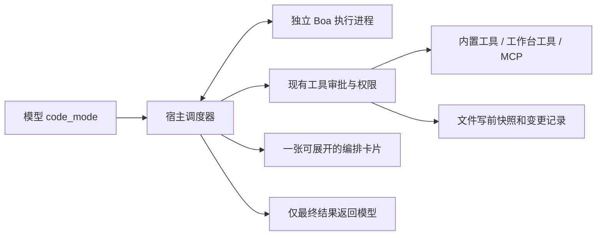

# Code Mode

Glint 通过一个 `code_mode` 工具接收 JavaScript 异步函数体。Agent 可以在一次模型往返中读取多个来源、复用前一步结果、筛选数据，再执行依赖步骤。普通工具继续保留；第一版减少往返和中间结果占用，尚未把全部工具定义替换成按需发现接口。

```javascript
const files = ["src/main.rs", "Cargo.toml"];
const pages = await Promise.all(
  files.map(path => tools.read_file({path, line_numbers: false, lines: 100}))
);
return pages.map((page, i) => ({
  path: files[i],
  total_lines: page.total_lines,
  complete: page.is_complete,
  excerpt: page.content.slice(0, 600)
}));
```

写操作沿用版本校验，避免将带行号或不完整的读取结果写回整个文件：

```javascript
const file = await tools.read_file({path: "src/main.rs", line_numbers: false});
await tools.replace_in_file({
  path: "src/main.rs",
  old: "let enabled = false;",
  new: "let enabled = true;",
  expected_sha256: file.expected_sha256
});
return {updated: "src/main.rs"};
```

## 执行链路



- 执行进程在原生 UI、工作区锁和数据库启动之前进入专用模式，不要求安装 Node。没有 `process`、`require`、`fetch`、定时器或系统 API；模块加载器显式禁用，文件和网络操作须经过宿主工具。
- 子调用只来自当前请求冻结的工具目录，继承相同项目、伙伴、会话、访问模式和回顾模式。禁止嵌套 `code_mode`、`subagent`。每次写操作、命令和其他敏感调用继续独立审批，批次本身不授予额外权限。
- `Promise.all` 中的可信内置只读调用最多并行 4 个。写操作、命令、宿主/MCP 调用以及需审批的调用是顺序屏障：等待前面的读取结束，再逐一执行；之后的读取继续排队。
- `await` 保证依赖顺序；同一波并发操作全部收到回复后，执行进程才继续脚本。未等待就直接返回的工具请求会被拒绝。必须返回 JSON 可序列化数据；不支持悬空 Promise。
- 第一版采用失败即停。任何子工具失败、拒绝审批、脚本错误、超时或取消都会停止后续工作；不能靠 `try/catch` 忽略工具失败后继续写入。已完成操作不会自动回滚、重试或重放。返回 `calls` 说明实际完成和失败的调用；恢复时仅补做剩余操作。
- 文件子调用使用既有原子写、SHA-256 校验和 SQLite 写前日志。嵌套变更参与会话汇总、`session_changes`、单文件/全部撤销及冲突校验。逐步进度保留到父工具记录，停止批次后已完成的文件修改仍然可见。
- 模型只收到最终 `value`、状态和紧凑调用清单。子调用结果不会逐条注入模型上下文。UI 可展开脚本和各个子调用；单条执行轨迹最多保存 64KiB 文本，截断有标记，脚本仍收到完整结果，完整文件前后版本单独保留。

## 资源边界

单批最多 64 次调用；代码和最终结果各最多 64KiB；单帧 RPC 最多 4MiB；默认总墙钟时间 120 秒，可设为 1–600 秒，包含等待审批时间。最多同时运行 2 个执行进程。VM 限制循环次数、递归和栈；Unix 子进程限制 CPU 时间；Linux 另设 512MiB 地址空间上限，macOS/Linux 宿主每 200ms 检查 RSS 并终止超过 512MiB 的进程。RSS 监控有采样间隔，不能保证瞬时内存绝不超限。Windows 当前保留 VM 和墙钟限制，未声称有同等内存/CPU 上限。

停止批次会关闭执行进程，并取消正在等待的宿主调用；前台命令进一步清理自身进程组。已成功启动并返回运行 ID 的后台命令属于已完成的启动操作，通过 `command_stop` 单独停止，退出应用时统一清理。

这里的能力边界是“进程隔离 + 不开放系统绑定 + 每次工具调用审批”，不是操作系统沙箱。批准的 `run_command` 仍以当前用户权限执行，工作目录不是文件访问隔离。

## 后续方向

按需工具搜索/Schema 查询可以进一步压缩大型 MCP 目录；持久化可恢复工作流则需要幂等键和外部系统确认，不能简单重放脚本。两者应独立于第一版编排执行器演进。

参考：[Cloudflare Code Mode](https://blog.cloudflare.com/code-mode/)、[Anthropic Code execution with MCP](https://www.anthropic.com/research/code-execution-with-mcp)。
