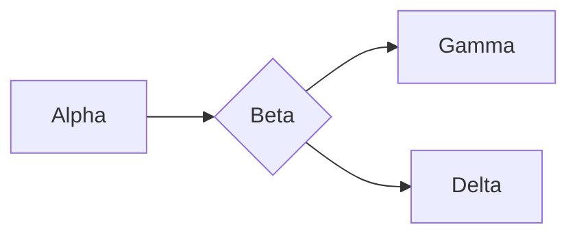

# 示例文档

Alpha、Beta、Gamma。这是一段占位文字，没有业务含义。

## 示例段落

段落 A，段落 B，段落 C。**文字甲**、*文字乙*、~~文字丙~~和 `value_01`。

Lorem ipsum dolor sit amet, consectetur adipiscing elit. Nulla facilisi.

> 引用 A。
> 引用 B。

### 示例列表

- 条目 A
  - 子条目 A.1
  - 子条目 A.2
- 条目 B

1. 条目一
2. 条目二
   - 子条目二 A
   - 子条目二 B

- [x] 占位项 A
- [ ] 占位项 B
- [ ] 占位项 C

## 示例表格

| 名称 | 数字 | 标记 |
| :--- | ---: | :---: |
| Alpha | 12 | A |
| Beta | 34 | B |
| Gamma | 56 | C |

## 示例代码

```rust
fn main() {
    let values = [1, 2, 3];
    println!("{:?}", values);
}
```

```go
func add(a, b int) int {
    return a + b
}
```

```json
{
  "name": "example",
  "enabled": true,
  "values": [1, 2, 3]
}
```

## 示例图表



---

[示例链接](https://example.com)。最后一段占位文字：A、B、C、D。
